<h1>
  <picture>
    <source media="(prefers-color-scheme: dark)" srcset="docs/assets/logo-dark.svg" />
    
  </picture>
</h1>

[](https://github.com/garage-sh/nudge/actions/workflows/ci.yml)
[](https://github.com/garage-sh/nudge/pkgs/container/nudge)
[](LICENSE)

<picture>
  <source media="(prefers-color-scheme: dark)" srcset="docs/assets/flow-dark.svg" />
  
</picture>

nudge collects feedback from the users of several applications, triages it and sends it where the team works. It is open-source (AGPL-3.0) and self-hosted.

- **Collect** from every application: an embeddable Widget (with optional, consent-based screenshots), a server SDK, or a plain HTTP API.
- **Triage** each Feedback with a Judge, a System One decision model (TypeSafe, OpenRouter or your own server): Type, Severity, Junk and Manipulation attempts.
- **Dispatch** it to the Project's Destinations whose Filter accepts it: Linear, GitHub Issues, Slack, Discord, Telegram, email, signed webhooks.
- **Route Incidents** reported by the applications' servers: repeated Occurrences grouped into one Incident, closed when the problem calms down.
- **Follow** everything from a dashboard, in English or French.

## Quick start

You need Docker and Docker Compose v2. No need to clone the repository: the compose file and the example configuration are enough.

```bash
mkdir nudge && cd nudge
curl -fsSL -o docker-compose.yml https://github.com/garage-sh/nudge/releases/latest/download/docker-compose.yml
curl -fsSL -o .env https://github.com/garage-sh/nudge/releases/latest/download/env.example
```

In `.env`, fill in the two required variables:

```bash
NUDGE_ENCRYPTION_KEY=$(openssl rand -base64 32)   # the value, not the command
NUDGE_POSTGRES_PASSWORD=$(openssl rand -hex 24)
```

Start the Instance, then read the setup token it prints:

```bash
docker compose up -d
docker compose logs nudge | grep 'setup token'
```

When `docker compose ps` shows `nudge` as `healthy`, open <http://localhost:8080> and create the first Member with that token. Then:

1. create a **Project**. Its public and secret keys are shown only once: write them down, or regenerate them later;
2. declare its **Allowed origins**, that is the sites where the Widget is installed (`https://app.example.com`);
3. add **Destinations**, with their Filter, and test them from the dashboard;
4. choose the **Judge** in **Settings**. Without one, nudge runs in degraded mode and every Verdict is Uncertain.

Before exposing the Instance, put it behind HTTPS: see [In production: HTTPS](docs/self-hosting.md#in-production-https).

## Sending Feedback

The quickest path is the Widget's script tag, on any page of a site listed in the Project's Allowed origins:

```html
<script
  src="https://nudge.example.com/widget/nudge-widget.js"
  data-public-key="nk_pub_…"
  data-api="https://nudge.example.com"
></script>
```

From a server, with an identity you can vouch for, use the SDK and the Project's secret key:

```ts
import { createClient } from '@nudge/sdk';

const nudge = createClient({
  url: 'https://nudge.example.com',
  secretKey: process.env.NUDGE_SECRET_KEY!,
});
await nudge.sendFeedback({ text: 'I cannot download my invoice', author: { id: 'u-42' } });
```

Or let a coding agent do the integration: `npx skills add garage-sh/nudge --skill integrate-nudge`. Every path is described in [Integrating a Project](docs/integration.md).

## Reporting Incidents

The same server can report what goes wrong on its side. nudge groups repeated Occurrences into one Incident, routes it by Level, Environment and context, and tells the Destinations when it closes, on the sender's word or after a Quiet period:

```ts
await nudge.sendIncident({
  title: 'Payment provider timed out',
  level: 'error',
  environment: 'production',
});
```

The coding agent skill is `integrate-nudge-incidents`. Read [Reporting Incidents](docs/incidents.md).

## Documentation

| Read                                             | For                                                                                    |
| ------------------------------------------------ | -------------------------------------------------------------------------------------- |
| [Integrating a Project](docs/integration.md)     | Widget (identity, language, page URL, Captures), React, JS SDK, HTTP API, coding agent |
| [Reporting Incidents](docs/incidents.md)         | Incidents from an application's server: grouping, Level, closing, routing, Storms      |
| [Destinations](docs/destinations.md)             | Destination types and what each needs; setting up Telegram                             |
| [Webhooks](docs/webhooks.md)                     | Webhook Destination: headers, payload, signature verification                          |
| [Self-hosting](docs/self-hosting.md)             | HTTPS and proxies, updating, verifying images, backing up, scaling                     |
| [Configuration](docs/configuration.md)           | Every environment variable, the Judge, outbound calls, Capture storage                 |
| [`SECURITY.md`](SECURITY.md)                     | Reporting a vulnerability, operating an Instance safely                                |
| [`docs/api/openapi.json`](docs/api/openapi.json) | The public API (OpenAPI 3.1)                                                           |
| [`CONTEXT.md`](CONTEXT.md)                       | The domain vocabulary (Project, Feedback, Triage, Verdict, Destination…)               |
| [`docs/adr/`](docs/adr/)                         | Architecture decisions                                                                 |

## Contributing

Read [`CONTRIBUTING.md`](CONTRIBUTING.md), then [Development](docs/development.md) to run nudge from source. To report a vulnerability, read [`SECURITY.md`](SECURITY.md).

## License

[AGPL-3.0](LICENSE). If you modify nudge and offer it as a service, you must publish your modifications.
